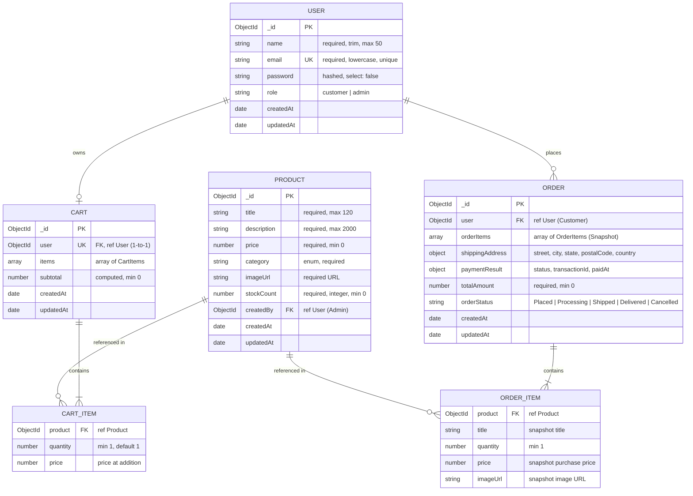

# Cartiva — Database Schema Design 🗄️

> **ALTA Builder 30 Challenge — Day 2: Database Schema & Data Modeling**  
> Database: **MongoDB** | ODM: **Mongoose**

This document defines the complete data architecture for Cartiva. It covers the four core models required for our e-commerce platform: **Users**, **Products**, **Cart**, and **Orders**.

---

## 💡 What is MongoDB & Mongoose? (Beginner Primer)

- **MongoDB** is a **NoSQL document database**. Instead of storing data in rigid tables with rows and columns (like SQL), it stores data in JSON-like flexible documents called **BSON** (Binary JSON).
- **Mongoose** is an **Object Data Modeling (ODM)** library for Node.js. It acts as a translator and validator between JavaScript and MongoDB, allowing us to:
  1. Define strict **Schemas** (blueprints with types and constraints).
  2. Perform automatic **data validations** (e.g., minimum price, required email).
  3. Establish **relationships/references** between documents using unique `ObjectId` identifiers.
  4. Automatically record creation and modification times via `timestamps: true`.

---

## 📊 Entity Relationship (ER) Diagram



---

## 🔒 Password Security & Hashing Architecture

Storing passwords in plain text is a severe security vulnerability. Cartiva adheres to standard cryptographic best practices:

1. **One-Way Salted Hashing (bcrypt):** Passwords are never stored as plain text. Instead, they pass through the `bcryptjs` algorithm using a **salt** (random bits added to the password) with a cost factor of 10 (`bcrypt.genSalt(10)`).
2. **Mongoose Pre-Save Hook:** Before a user document is saved to the database, a `pre('save')` hook detects if the password field was modified and automatically hashes it before writing to disk.
3. **Defense-in-Depth (`select: false`):** In the User schema, `password: { select: false }` ensures that query operations (`User.find()`, `User.findById()`) will exclude the password hash by default, preventing accidental leakage in API responses.

```javascript
// Pre-save hook demonstration (Mongoose)
userSchema.pre('save', async function (next) {
  if (!this.isModified('password')) return next();
  const salt = await bcrypt.genSalt(10);
  this.password = await bcrypt.hash(this.password, salt);
  next();
});
```

---

## 🗂️ 1. User Model (`User.js`)

Manages accounts for both **Customers** and **Admins** using Role-Based Access Control (`role`).

```javascript
const userSchema = new mongoose.Schema(
  {
    name: {
      type: String,
      required: [true, 'Please provide your full name'],
      trim: true,
      maxlength: [50, 'Name cannot exceed 50 characters']
    },
    email: {
      type: String,
      required: [true, 'Please provide an email address'],
      unique: true,
      lowercase: true,
      trim: true,
      match: [
        /^\w+([.-]?\w+)*@\w+([.-]?\w+)*(\.\w{2,3})+$/,
        'Please provide a valid email address'
      ]
    },
    password: {
      type: String,
      required: [true, 'Please provide a password'],
      minlength: [6, 'Password must be at least 6 characters long'],
      select: false // Excluded from query results by default
    },
    role: {
      type: String,
      enum: {
        values: ['customer', 'admin'],
        message: '{VALUE} is not a valid role'
      },
      default: 'customer'
    }
  },
  {
    timestamps: true // Automatically creates createdAt and updatedAt fields
  }
);
```

### Field Breakdown:
| Field | Type | Constraints & Validations | Purpose |
| :--- | :--- | :--- | :--- |
| `_id` | `ObjectId` | Auto-generated Primary Key | Unique document identifier. |
| `name` | `String` | `required`, `trim`, `maxlength: 50` | Full name of user. |
| `email` | `String` | `required`, `unique`, `lowercase`, regex check | User identity & login handle. |
| `password` | `String` | `required`, `minlength: 6`, `select: false` | Hashed bcrypt string. |
| `role` | `String` | `enum: ['customer', 'admin']`, default: `'customer'` | Controls authorization permissions. |
| `timestamps` | `Date` | Managed automatically by Mongoose | `createdAt` & `updatedAt`. |

---

## 🛍️ 2. Product Model (`Product.js`)

Defines the products displayed in the customer catalogue and managed by store administrators.

```javascript
const productSchema = new mongoose.Schema(
  {
    title: {
      type: String,
      required: [true, 'Please enter product title'],
      trim: true,
      maxlength: [120, 'Title cannot exceed 120 characters']
    },
    description: {
      type: String,
      required: [true, 'Please enter product description'],
      trim: true,
      maxlength: [2000, 'Description cannot exceed 2000 characters']
    },
    price: {
      type: Number,
      required: [true, 'Please enter product price'],
      min: [0, 'Price must be a positive number']
    },
    category: {
      type: String,
      required: [true, 'Please assign a category'],
      enum: {
        values: ['Electronics', 'Fashion', 'Home & Kitchen', 'Books', 'Fitness', 'Other'],
        message: '{VALUE} is not an allowed category'
      },
      default: 'Other'
    },
    imageUrl: {
      type: String,
      required: [true, 'Please provide a product image URL'],
      trim: true
    },
    stockCount: {
      type: Number,
      required: [true, 'Please specify stock quantity'],
      min: [0, 'Stock count cannot be negative'],
      default: 0
    },
    createdBy: {
      type: mongoose.Schema.Types.ObjectId,
      ref: 'User',
      required: true // Foreign key pointing to Admin User
    }
  },
  {
    timestamps: true
  }
);
```

### Field Breakdown:
| Field | Type | Constraints & Validations | Purpose |
| :--- | :--- | :--- | :--- |
| `title` | `String` | `required`, `trim`, `maxlength: 120` | Name of the product. |
| `description`| `String` | `required`, `maxlength: 2000` | Full details, specifications, and features. |
| `price` | `Number` | `required`, `min: 0` | Price in standard currency units (INR ₹). |
| `category` | `String` | `enum`, `required`, default: `'Other'` | Categorization for filtering. |
| `imageUrl` | `String` | `required`, `trim` | High-resolution image link for display. |
| `stockCount` | `Number` | `required`, `min: 0`, default: `0` | Available inventory tracking. |
| `createdBy` | `ObjectId` | Reference `ref: 'User'`, `required` | Admin provenance tracking. |
| `timestamps` | `Date` | Managed automatically by Mongoose | Catalog audit tracking. |

---

## 🛒 3. Cart Model (`Cart.js`)

Manages the persistent shopping cart for registered users. While anonymous visitors browse with browser LocalStorage, logged-in users synchronize with this Cart document.

```javascript
const cartItemSchema = new mongoose.Schema(
  {
    product: {
      type: mongoose.Schema.Types.ObjectId,
      ref: 'Product',
      required: [true, 'Product reference is required']
    },
    quantity: {
      type: Number,
      required: true,
      min: [1, 'Quantity must be at least 1'],
      default: 1
    },
    price: {
      type: Number,
      required: true,
      min: [0, 'Item price cannot be negative']
    }
  },
  { _id: false } // Subdocument does not require its own ObjectId
);

const cartSchema = new mongoose.Schema(
  {
    user: {
      type: mongoose.Schema.Types.ObjectId,
      ref: 'User',
      required: true,
      unique: true // Exactly 1 active cart per customer
    },
    items: [cartItemSchema],
    subtotal: {
      type: Number,
      required: true,
      default: 0,
      min: 0
    }
  },
  {
    timestamps: true
  }
);
```

### Field Breakdown:
| Field | Type | Constraints & Validations | Purpose |
| :--- | :--- | :--- | :--- |
| `user` | `ObjectId` | Reference `ref: 'User'`, `unique: true` | Links 1-to-1 with a customer. |
| `items` | `Array` | List of `cartItemSchema` | Contains product references, quantities, and prices. |
| `items.product`| `ObjectId` | Reference `ref: 'Product'` | Identifies which catalog product is in the cart. |
| `items.quantity`| `Number` | `min: 1`, default: `1` | Count of selected items. |
| `items.price` | `Number` | `min: 0` | Unit price at time of addition. |
| `subtotal` | `Number` | `min: 0`, default: `0` | Sum of all `quantity * price` entries. |
| `timestamps` | `Date` | Managed automatically by Mongoose | Tracks cart freshness and abandonment. |

---

## 📦 4. Order Model (`Order.js`)

Stores finalized purchases. Once created, orders are immutable historical records representing confirmed financial agreements.

```javascript
const orderItemSchema = new mongoose.Schema(
  {
    product: {
      type: mongoose.Schema.Types.ObjectId,
      ref: 'Product',
      required: true
    },
    title: { type: String, required: true },
    quantity: { type: Number, required: true, min: 1 },
    price: { type: Number, required: true, min: 0 },
    imageUrl: { type: String, required: true }
  },
  { _id: false }
);

const orderSchema = new mongoose.Schema(
  {
    user: {
      type: mongoose.Schema.Types.ObjectId,
      ref: 'User',
      required: true // Foreign key pointing to Customer User
    },
    orderItems: {
      type: [orderItemSchema],
      validate: [val => val.length > 0, 'An order must contain at least one item']
    },
    shippingAddress: {
      street: { type: String, required: [true, 'Street address is required'] },
      city: { type: String, required: [true, 'City is required'] },
      state: { type: String, required: [true, 'State is required'] },
      postalCode: { type: String, required: [true, 'Postal code is required'] },
      country: { type: String, required: true, default: 'India' }
    },
    paymentResult: {
      status: {
        type: String,
        required: true,
        default: 'COMPLETED_TEST_MODE'
      },
      transactionId: {
        type: String,
        required: true,
        default: () => `TEST-TXN-${Date.now()}`
      },
      paidAt: {
        type: Date,
        default: Date.now
      }
    },
    totalAmount: {
      type: Number,
      required: true,
      min: [0, 'Total amount cannot be negative']
    },
    orderStatus: {
      type: String,
      required: true,
      enum: {
        values: ['Placed', 'Processing', 'Shipped', 'Delivered', 'Cancelled'],
        message: '{VALUE} is not a valid order status'
      },
      default: 'Placed'
    }
  },
  {
    timestamps: true
  }
);
```

### Field Breakdown:
| Field | Type | Constraints & Validations | Purpose |
| :--- | :--- | :--- | :--- |
| `user` | `ObjectId` | Reference `ref: 'User'`, `required` | Owner of the order. |
| `orderItems` | `Array` | Non-empty array of snapshots | Frozen snapshot of items (title, price, image, qty). |
| `shippingAddress` | `Object` | Required street, city, state, postalCode | Delivery destination. |
| `paymentResult` | `Object` | Transaction ID, status, timestamp | Payment audit trail (Test-mode / Gateway). |
| `totalAmount` | `Number` | `required`, `min: 0` | Final payable balance. |
| `orderStatus` | `String` | `enum`, default: `'Placed'` | Lifecycle milestone (*Placed* ➔ *Delivered*). |
| `timestamps` | `Date` | Managed automatically by Mongoose | Date of purchase & status update times. |

---

## 💡 Important Database Design Patterns Used

### 1. Snapshot Pattern (Immutable History)
In the `Order` model, we deliberately duplicate `title`, `price`, and `imageUrl` rather than merely storing the `product` ID.
- *Why?* If an administrator updates the price of a headphone from ₹2,499 to ₹2,999 tomorrow, past orders must still prove that the customer purchased it for ₹2,499. If the product is later deleted, the customer's order receipt remains completely intact.

### 2. Transient vs. Immutable Data
- **`Cart`** is **transient & mutable**: Items are added, removed, and quantities are adjusted frequently.
- **`Order`** is **permanent & immutable**: Once submitted, it cannot be arbitrarily edited; its state only transitions through the fulfillment pipeline.

### 3. Normalization vs. Denormalization Balance
- We normalize `User` and `Product` (referenced by `ObjectId`) to prevent data inconsistency across general operations.
- We denormalize order items and shipping addresses inside `Order` to guarantee fast reads and historical accuracy without complex multi-collection joins.

---

## 📖 Related Documents

- [README.md](./README.md) — Project overview & tech stack.
- [FEATURES.md](./FEATURES.md) — 10 MVP features & role mapping.
- [API.md](./API.md) — RESTful API endpoint design and specifications.
- [WIREFRAMES.md](./docs/WIREFRAMES.md) — UI wireframes and screen layouts.
