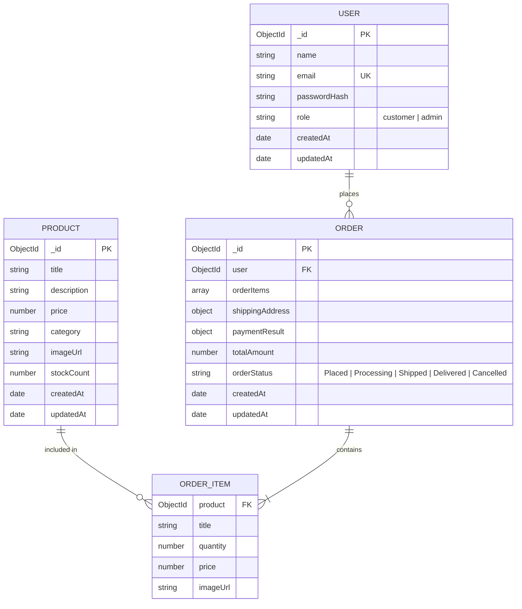

# Cartiva — Database Schema Design 🗄️

> **ALTA Builder 30 Challenge — Day 2: Database Schema & Data Modeling**  
> Technology: **MongoDB with Mongoose ODM**

This document defines the data models and relationships powering Cartiva. As a beginner-friendly reference, each model includes field definitions, data types, constraints, and the rationale behind each design choice.

---

## 💡 What is MongoDB & Mongoose? (Beginner Primer)

- **MongoDB** is a **NoSQL document database**. Instead of storing data in rigid tables with rows and columns (like SQL), it stores data in JSON-like flexible documents called **BSON**.
- **Mongoose** is an **Object Data Modeling (ODM)** library for Node.js. It gives structure to MongoDB by letting us define strict **Schemas** (blueprints), enforce validations (e.g., required fields, unique emails), and easily query the database using JavaScript.

---

## 📊 Entity Relationship (ER) Diagram



---

## 🗂️ 1. User Model (`User.js`)

Represents both **Customer** and **Admin** accounts via Role-Based Access Control (`role` field).

```javascript
{
  name: {
    type: String,
    required: [true, 'Please provide your full name'],
    trim: true,
    maxlength: 50
  },
  email: {
    type: String,
    required: [true, 'Please provide an email address'],
    unique: true,
    lowercase: true,
    trim: true,
    match: [
      /^\w+([.-]?\w+)*@\w+([.-]?\w+)*(\.\w{2,3})+$/,
      'Please provide a valid email address'
    ]
  },
  password: {
    type: String,
    required: [true, 'Please provide a password'],
    minlength: 6,
    select: false // Excluded from query results by default for security
  },
  role: {
    type: String,
    enum: ['customer', 'admin'],
    default: 'customer'
  },
  createdAt: {
    type: Date,
    default: Date.now
  }
}
```

### Key Concepts:
- **`unique: true` on `email`:** Prevents duplicate accounts with the same email.
- **`select: false` on `password`:** Ensures that whenever we fetch user records, password hashes are never accidentally sent to the frontend.
- **`role`:** Controls authorization. Regular registrations default to `'customer'`, while designated administrators have `'admin'`.

---

## 🛍️ 2. Product Model (`Product.js`)

Stores item listings for the customer catalogue and admin inventory.

```javascript
{
  title: {
    type: String,
    required: [true, 'Please enter product title'],
    trim: true,
    maxlength: 120
  },
  description: {
    type: String,
    required: [true, 'Please enter product description'],
    maxlength: 2000
  },
  price: {
    type: Number,
    required: [true, 'Please enter product price'],
    min: [0, 'Price cannot be negative']
  },
  category: {
    type: String,
    required: [true, 'Please assign a category'],
    enum: ['Electronics', 'Fashion', 'Home & Kitchen', 'Books', 'Fitness', 'Other'],
    default: 'Other'
  },
  imageUrl: {
    type: String,
    required: [true, 'Please provide a product image URL'],
    default: 'https://placehold.co/600x400?text=Product+Image'
  },
  stockCount: {
    type: Number,
    required: [true, 'Please specify available stock count'],
    min: [0, 'Stock count cannot be negative'],
    default: 0
  },
  createdBy: {
    type: mongoose.Schema.Types.ObjectId,
    ref: 'User',
    required: true // Tracks which admin created this item
  },
  createdAt: {
    type: Date,
    default: Date.now
  }
}
```

### Key Concepts:
- **`category`:** Uses an `enum` constraint so products are filed into consistent, filterable departments.
- **`stockCount`:** Tracked as an integer to prevent selling products with 0 stock.
- **`createdBy`:** A Mongoose reference (`ref: 'User'`) that creates a relational link between the product and the admin who created it.

---

## 📦 3. Order Model (`Order.js`)

Stores completed checkout orders, snapshot of purchased items, shipping destination, and test payment status.

```javascript
{
  user: {
    type: mongoose.Schema.Types.ObjectId,
    ref: 'User',
    required: true
  },
  orderItems: [
    {
      product: {
        type: mongoose.Schema.Types.ObjectId,
        ref: 'Product',
        required: true
      },
      title: { type: String, required: true },
      quantity: { type: Number, required: true, min: 1 },
      price: { type: Number, required: true },
      imageUrl: { type: String, required: true }
    }
  ],
  shippingAddress: {
    street: { type: String, required: true },
    city: { type: String, required: true },
    state: { type: String, required: true },
    postalCode: { type: String, required: true },
    country: { type: String, required: true, default: 'India' }
  },
  paymentResult: {
    status: { type: String, default: 'COMPLETED_TEST_MODE' },
    transactionId: { type: String, default: () => `TEST-TXN-${Date.now()}` },
    paidAt: { type: Date, default: Date.now }
  },
  totalAmount: {
    type: Number,
    required: true,
    min: 0
  },
  orderStatus: {
    type: String,
    enum: ['Placed', 'Processing', 'Shipped', 'Delivered', 'Cancelled'],
    default: 'Placed'
  },
  createdAt: {
    type: Date,
    default: Date.now
  }
}
```

### Key Concepts:
- **Embedded `orderItems` (Snapshot Pattern):** Notice we store `title`, `price`, and `imageUrl` directly inside each order item in addition to the `product` ID. Why? If an admin later edits a product's price or deletes it, historical customer orders must retain the exact price and name at the moment the purchase occurred.
- **`paymentResult`:** Records test-mode transaction details (mock transaction ID and timestamp) for MVP testing.
- **`orderStatus`:** Enforces standard lifecycle stages for order progression.

---

## 📖 Related Documents

- [README.md](./README.md) — Project overview & tech stack.
- [FEATURES.md](./FEATURES.md) — 10 MVP features & role mapping.
- [API.md](./API.md) — RESTful API endpoint design and specifications.
